<h2 align="center">Hi, I'm Rishab 👋</h2>

<p align="center">
  
</p>

<p align="center">
  <a href="https://rishabdugarjain.in"></a>
</p>

<p align="center">
  <a href="https://www.linkedin.com/in/rishabdugar/"></a>
  <!-- DEVTO-FOLLOWERS:START --><a href="https://dev.to/rishabdugar"></a><!-- DEVTO-FOLLOWERS:END -->
  <a href="https://rishabdugarjain.hashnode.dev"></a>
  <a href="https://leetcode.com/u/rishabdugar/"></a>
  <a href="https://codolio.com/profile/rishabdugar"></a>
  <a href="https://linktr.ee/rishabdugar"></a>
  <a href="mailto:rishabdugar.tech@gmail.com"></a>
  
</p>

I teach language models to behave like dependable software. Most days, they listen.

Senior Data Scientist. Before that, three years shipping chat and voice AI that people called ~150K times a month, and mostly didn't hang up on.

```python
rishab = {
    "day_job": "Senior Data Scientist",
    "currently_into": ["causal ML", "uplift models", "agents that know when to stop"],
    "previously": "conversational AI, RAG, multi-agent platforms",
    "certified_in": ["AWS", "GCP", "Azure", "Claude Architect (Foundations + Professional)"],  # collecting them like Infinity Stones
    "competitive_programming": {"LeetCode": "Knight", "CodeChef": "4★ (peak)"},
    "side_quest": "fizzdoc.com",
    "off_duty": ["cosmology", "badminton", "sketching", "shayari"],
}
```

### 🛠️ Things I've built (and would show my manager)

- **[Fizzdoc](https://github.com/kingrishabdugar/fizzdoc)**: 70+ PDF, image, audio and Office tools that run inside your browser tab. Your files never leave it, and CI fails the build if a single request even tries. TypeScript + WebAssembly. Try it at [fizzdoc.com](https://fizzdoc.com).
- **A multi-agent platform**: 20+ agents, 40+ tools, ~1,000 concurrent users, and one very patient orchestrator.
- **A voice + chat assistant** with sub-2s voice authentication, because nobody enjoys saying their date of birth twice.
- **[Gyanshala](https://gyanshala.pages.dev)**: learning games for kids, each one a single HTML file. No backend, no ads, no server bill.
- **Open source**: I also contribute to [Google's elephant-goldfish-model](https://github.com/google/elephant-goldfish-model/graphs/contributors), with merged fixes to its packaging and tooling.

<p align="center">
  <a href="https://github.com/kingrishabdugar/fizzdoc"></a>
</p>

### 🧠 Things I've learned the hard way

- When RAG hallucinates, blame the retrieval before you blame the model.
- An agent without a stopping condition is just an expensive `while True`.
- Most problems turn out to be O(n log n) once you stop panicking. Competitive programming taught me that; production reminded me.

### ✍️ Recent writing

- [The architecture of a website that can't see your files](https://rishabdugarjain.hashnode.dev/the-architecture-of-a-website-that-can-t-see-your-files-74-tools-no-backend)
- [I don't run analytics on my site. Here's what 273,000 requests told me anyway.](https://rishabdugarjain.hashnode.dev/i-don-t-run-analytics-on-my-site-here-s-what-273-000-requests-told-me-anyway)
- [Someone asked if my tools were accessible, so I tested every page](https://rishabdugarjain.hashnode.dev/someone-asked-if-my-75-tools-were-accessible-i-didn-t-know-so-i-tested-every-page)

Same posts, your favourite platform:

<p>
  <a href="https://rishabdugarjain.hashnode.dev"></a>
  <a href="https://medium.com/@rishabdugarjain"></a>
  <a href="https://dev.to/rishabdugar"></a>
  <a href="https://www.geeksforgeeks.org/user/kingrishabdugar/"></a>
</p>

### 🧰 Toolbox

<p align="center">
  
</p>

<table align="center">
  <tr>
    <td align="right"><b>🧪 Data science &amp; ML</b></td>
    <td>
      
      
      
      
      
      
    </td>
  </tr>
  <tr>
    <td align="right"><b>🤖 GenAI &amp; agents</b></td>
    <td>
      
      
      
      
      
      
    </td>
  </tr>
  <tr>
    <td align="right"><b>🗄️ Data &amp; MLOps</b></td>
    <td>
      
      
      
      
      
    </td>
  </tr>
  <tr>
    <td align="right"><b>☁️ Cloud &amp; backend</b></td>
    <td>
      
      
      
      
      
      
      
    </td>
  </tr>
</table>

### 📊 GitHub, by the numbers

<p align="center">
  
  
</p>

<p align="center">
  
</p>

<p align="center">
  
</p>

<p align="center">
  
</p>

### 🏆 Competitive programming

<p align="center">
  <a href="https://leetcode.com/u/rishabdugar/"></a>
</p>

<p align="center">
  <a href="https://leetcode.com/u/rishabdugar/"></a>
  <a href="https://www.codechef.com/users/kingrishab"></a>
  <a href="https://codolio.com/profile/rishabdugar"></a>
</p>

### 😄 Break time

<p align="center">
  
</p>

<p align="center">
  
</p>

<p align="center"><sub>Refresh for a new joke. If you read this far, you're either a recruiter or my mom. Hi to both.</sub></p>
